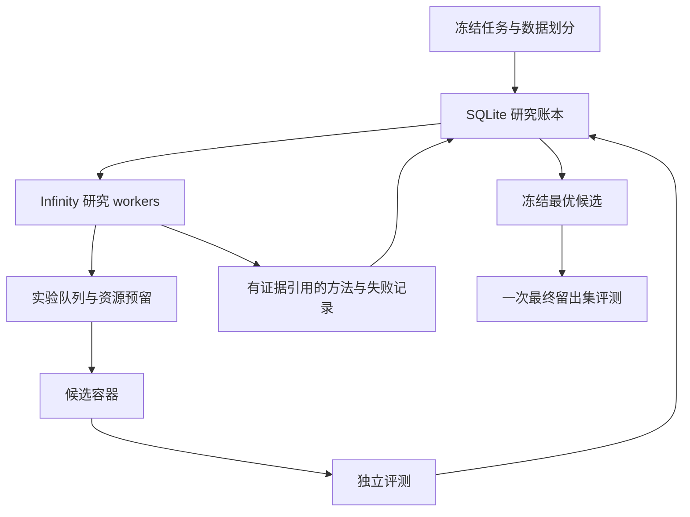

# Infinity 自主研究

这部分把 Infinity 的原生并发 agent 接到持久的工作、工具和证据系统上。通用内核负责目标拆分、并行执行、等待子任务、恢复与汇合；具体研究方法由 skill 提供，运行和检查由工具提供。

## 通用任务入口

新增的 **schema 2** 不要求数据集、标量分数或留出集。它提供持久任务图、原生 worker 按需唤醒、动态工具目录和 12 个按需加载的内置 skill。目前接入通用 Python 执行与精确正方形构造检查。详细说明见 [通用架构](docs/general-agent-architecture.md)，运行示例见 [generic-research](examples/generic-research/README.md)。

```bash
python3 -m pip install -e ./research
python3 -m infinity_research.cli init \
  --task research/examples/generic-research/task.json \
  --campaign research/runs/generic-001
```

随后仍用同一个 Rust `infinity-research` launcher；模型参数与下文相同。精确检查示例不执行生成代码，因此不需要 Docker；通用生成代码执行使用预先构建的 Docker 镜像。

原有 **schema 1** 保留完整比赛实验链，第一份适配是 [Solar Filament Segmentation Challenge 2026](https://www.kaggle.com/competitions/filament-segmentation-2026)。下文的训练、留出集和四个固定工具专门描述这一兼容模式。

数学领域的进一步设计见 [数学研究架构](docs/mathematical-research.md)：构造、搜索方法、命题依赖与上下界需要分别维护。通用任务图和精确构造工具现已接入；完整证明图、Lean、全规模 Kaggle packing 适配仍未实现。

## 比赛兼容模式的运行结构

- **Rust `infinity-research`** 使用 `AgentSystemBuilder`、原生 thread 和异步 tool result。worker 等待训练时让出执行；模型并发和实验并发分别限制。
- **Python backend** 使用 SQLite WAL 保存任务版本、候选谱系、工作队列、预算、结果和方法记录。多进程领取实验槽位是事务操作。
- **执行器** 在预先构建的 Docker 镜像中运行候选。候选只能读源码和公开输入，写自己的产物；训练结束后由宿主评测。
- **领域适配器** 负责数据准备、预测格式和正确性/指标检查。运行器不把某个比赛的模型结构写死。



运行时开放四个工具：`research_context`、`run_experiment`、`read_candidate`、`record_finding`。worker 可以改候选的完整 Python 源码，并读取已有候选继续发展。分数、数据划分、预算和最终评测不由模型写入。

## 先运行不花模型费用的完整检查

在仓库根目录：

```bash
python3 -m pip install -e ./research
python3 -m infinity_research.cli smoke --output /tmp/infinity-research-smoke
```

它会在一个小回归数据集上真实运行两个 Python 候选，独立比较 MSE，验证重复候选复用，再对选中的程序做一次留出集评测。输出 `report.json`。这是架构测试；没有调用 LLM，也不代表 Kaggle 成绩。

```bash
PYTHONPATH=research python3 -m unittest discover -s research/tests -v
cargo test -p infinity-research --locked
cargo clippy -p infinity-research --all-targets --locked -- -D warnings
```

原生 Rust 测试包含 Mock provider 和真实 Python backend 的组合：原生工具调用、实际子进程执行、评分、继续研究、预算停止、最终评测和重启。
实际执行的检查、结果和未验证部分见 [验证记录](VALIDATION.md)。

## Solar Filament：从数据到无人值守运行

需要 Linux/WSL、Python 3.11+、当前 stable Rust 和可用的 Docker。本次使用 Rust 1.99.1 验证；文件锁接口本身要求 Rust 1.89 或以上，完整依赖的最低兼容版本未单独验证。比赛任务默认每个实验使用一张 GPU；Docker GPU 模式还需要宿主的 NVIDIA Container Toolkit。CPU 配置可以把 `executor.gpus` 改为 `0`，并重新设置时间预算。

macOS 只支持可信的离线 `smoke` 示例；该示例明确不施加地址空间上限，并在结果中记录 `memory_enforced: false`。正式领域的初始化会在 macOS 提前拒绝。Linux/WSL 保留地址空间与 CPU 限制，不能把 macOS 示例通过当成正式比赛运行环境已验证。

### 1. 准备环境和官方比赛数据

```bash
python3 -m venv research/.venv
. research/.venv/bin/activate
python -m pip install -e './research[filament]'
docker build -t infinity-research-filament:local research/examples/filament-segmentation-2026
```

使用已获准访问的 Kaggle 比赛训练图像、训练 COCO JSON，以及可选的无标签 test 图像。代码不下载外部 MAGFiLO 标注。实际目录按下载内容填写：

```bash
python -m infinity_research.cli prepare-filament \
  --images /data/filament/train/train_images \
  --annotations /data/filament/train/MAGFiLO_1.0_Annotations_kaggle2026_train.json \
  --test-images /data/filament/test \
  --output /data/filament-prepared
```

准备阶段按观测日期分组；同一图像的不同标注版本以及字节完全相同的重复观测不会跨划分。缺失日期、图像重名、train/test 重叠、维度错误会直接报错。数据量从实际文件统计，不依赖写死的比赛样本数。

目录分成三个公开视图和宿主私有标签：

| 目录 | 内容 | 使用时机 |
| --- | --- | --- |
| `public/` | 训练图像与训练标签、无标签 validation 图像、可选无标签 test 图像 | 日常研究 |
| `public_final/` | 同一训练集、无标签 holdout 图像 | 最终评测 |
| `public_test/` | 同一训练集、无标签 Kaggle test 图像 | 可选测试预测 |
| `private/` | validation/holdout 标签、完整划分与数据校验记录 | 仅宿主评测器 |

`public_test` 只有提供 test 图像时生成。最终留出集来自比赛训练数据，和 Kaggle 的隐藏 test labels 是不同概念。

### 2. 固定任务和预算

编辑 [比赛任务配置](examples/filament-segmentation-2026/task.json)，然后初始化：

```bash
python -m infinity_research.cli init \
  --task research/examples/filament-segmentation-2026/task.json \
  --data /data/filament-prepared \
  --campaign research/runs/filament-001
```

初始化保存数据/评测器指纹、基线源码和完整任务快照。Docker tag 会解析并固定为本地镜像 ID；缺少 Docker 或镜像时在启动研究前报错。更改数据、指标或预算后，建立新的 campaign，不覆盖旧结果。

示例预算为：8 个逻辑 worker 上限、1 个并发 GPU 实验、160 次模型请求、24 个实验、每实验最多 3600 秒，总实验时间 86400 秒，总墙钟时间 172800 秒。它们是示例的硬上限，不是预计成本或推荐必须跑满的时长。

`final_trial_seconds` 包含在总实验预算内；搜索不能占用它。墙钟时间也为最终阶段和清理预留时间。每个实验的超时覆盖输入校验、执行和评测；其中最多 120 秒、通常 20% 的余量优先留给独立评测。

模型费用通过**请求次数上限和每次输出 token 上限**约束。输入 token 和实际用量会记录；这里没有把它们换算成精确美元硬限额，也不声称模型调用数量相同就费用相同。
单次模型请求默认最长 900 秒，可用 `--model-call-timeout-seconds` 调整，并会进一步收紧到剩余搜索时间；持续输出的流也受这个期限限制。

### 3. 启动原生 Infinity workers

下面三个变量由你选择的模型服务决定。不要把密钥写入任务 JSON 或候选文件：

```bash
export RESEARCH_API_KEY='your-provider-key'
export RESEARCH_API_BASE='https://your-provider.example/v1'
export RESEARCH_MODEL='your-provider-model'

cargo run --release -p infinity-research -- \
  --campaign research/runs/filament-001 \
  --research-root research \
  --python research/.venv/bin/python \
  --provider openai-compatible \
  --api-base "$RESEARCH_API_BASE" \
  --api-key-env RESEARCH_API_KEY \
  --model "$RESEARCH_MODEL" \
  --workers 4
```

OpenAI-compatible 模式使用 Chat Completions。模型必须支持工具调用；provider 的 reasoning/thinking 扩展可能有额外要求，见 [原生 launcher 说明](../crates/infinity-research/README.md)。也支持 Infinity 已有的 remote model provider 协议。

正常预算结束后，launcher 等待已接纳的实验结束，再自动运行一次最终评测。`--no-finalize` 可以保留人工选择最终评测时机。Ctrl-C、宿主主动停止或基础设施故障不会自动启动最终评测。

### 4. 看进展、重启和导出

```bash
python -m infinity_research.cli status --campaign research/runs/filament-001
python -m infinity_research.cli report \
  --campaign research/runs/filament-001 --output /tmp/filament-report.json
```

再次运行同一个 Rust 命令，会先恢复已入账的排队工作，再从账本创建新的 worker 上下文。原始 LLM 对话保存在当前进程内；跨进程恢复的是实验、证据和研究经验，不承诺恢复未记录的推理文本或优化器的中间状态。

异常丢失的运行任务在硬截止时间后记为 `interrupted`，保守收取其已预留时间，不静默当作成功。候选内容和 seed 相同的重试复用已有结果；做受控重复实验时使用不同 seed。

```bash
python -m infinity_research.cli stop --campaign research/runs/filament-001
python -m infinity_research.cli finalize --campaign research/runs/filament-001
```

`stop` 取消排队工作，让运行中的实验结束。`finalize` 只在没有活动实验时接受；一旦最终评测启动，失败或中断也不会自动重试。最终分数不回流到研究 worker 上下文。

模型产物在 `candidates/<id>/output/`，执行日志在旁边的 `output.execution.log`，宿主评分与证据在 `evaluation.json`。候选自己打印的分数和日志始终是诊断信息，不会更新最优候选。

最终评测成功后，可以显式执行冻结程序，在无标签 test 图像上生成预测，再导出经过覆盖与 RLE 检查的 CSV：

```bash
python -m infinity_research.cli predict-test \
  --campaign research/runs/filament-001 \
  --output /data/test-predictions \
  --timeout-seconds 3600

python -m infinity_research.cli export-filament-submission \
  --data /data/filament-prepared \
  --predictions-dir /data/test-predictions \
  --output /data/submission.csv
```

`predict-test` 固定成功 final 记录的源码、seed 和镜像，完整重跑该程序，可能重新训练；它不复用 checkpoint，也不读取测试标签。这是有单独超时的额外运行，不计入已关闭的研究预算。输出目录、同级 `.source` 目录和 `.test_execution.json` 记录文件必须是新路径，并位于数据集和 campaign 之外；宿主执行记录放在候选不可写的位置，保存来源和执行状态。预测格式由后续导出命令检查。详细契约见 [比赛适配说明](examples/filament-segmentation-2026/README.md)。导出命令不上传 Kaggle；当前自动研究的完成边界是选优和一次最终留出集评测。

## 研究过程如何推进

worker 看到当前最好方案、最近实验、失败日志、候选父子关系和共享方法记录。系统用各研究方向的尝试次数、改进次数和当前负载给出下一方向建议，并为尚少探索的方向保留优先级。这个建议不决定科学正确性。

实验完成后，宿主负责晋级；很小的真实改进也能成为最好候选。`min_delta` 只用于判断是否取得有意义的进展和是否需要重新规划。停止进展时，worker 被提示改变假设、表示或方法。

`method` 记录可以引用产生它的实验，再通过 `read_candidate` 复用对应实现。本版没有自动改写宿主调度器、评分程序或工具权限，也没有实现跨比赛训练一个新的策略模型。

## 并发和边界

- 同一 campaign 只允许一个 native launcher，使用操作系统文件锁，进程退出自动释放。
- 模型请求额度在调用 provider 之前通过 SQLite 原子预留。请求失败也消耗额度，避免无限免费重试循环。
- 实验槽位和总时间在事务中预留；暂时排满不会被误判成永久结束。
- 存活的执行进程可代领最早排队任务；正常预算结束时，launcher 还会接手账本中剩余的排队工作，再进入最终评测。
- GPU 通过配置中的设备 ID 分配；100 个逻辑 worker 不代表同时启动 100 个 GPU 训练。
- Docker 清理失败、数据契约变化等宿主故障会停止新实验，保留错误原因。
- 日志和产物有上限，候选进程退出后会清理后代；产物上限是周期监测后终止，不是文件系统配额。
- SQLite 与文件锁面向单宿主/WSL。多机器队列、分布式资源租约和训练 checkpoint 精确续跑没有包含在这个版本内。

## 接另一场比赛

实现一个宿主领域模块，提供：

1. 数据准备，产生版本化的公开输入和私有验证/最终评测资料。
2. 一个可运行候选基线及固定输入/输出契约。
3. `evaluate(prepared_root, output_dir, split=...)`，返回有限的 `score`、固定 `metric` 和可追查的详情。
4. 任务配置、指标方向、资源预算和研究方向列表。

在 `domains.get_domain` 和 `spec.validate` 中注册。原生 worker、事务预算、候选谱系、去重、进程清理和恢复流程可以复用。当前提供 `filament` 和离线 `smoke` 两个实现；数学问题仍需要专门的命题与证明检查适配，不能直接宣称已经支持任意定理证明。
