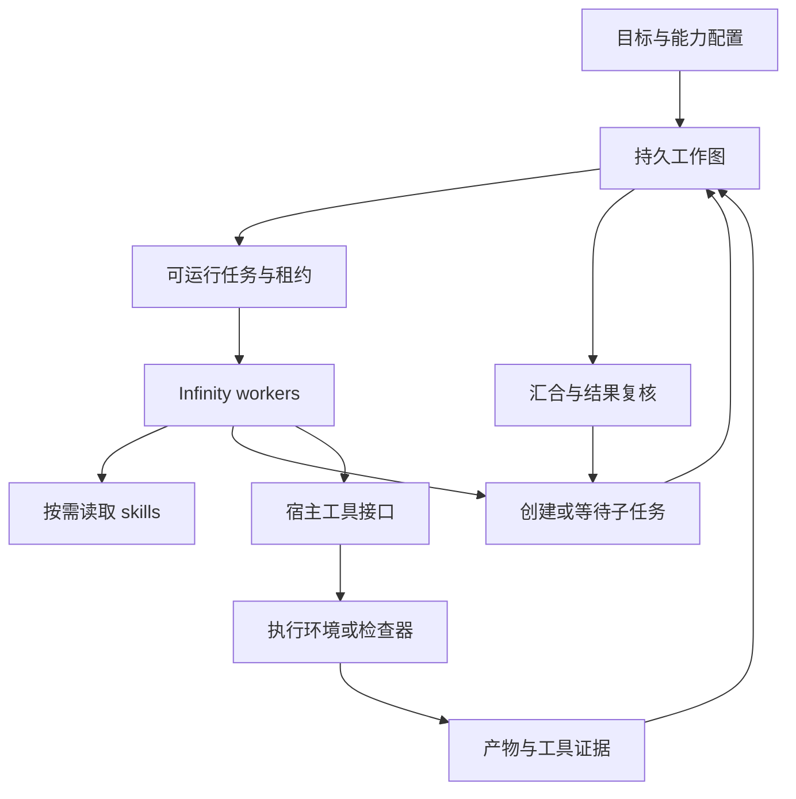

# 通用自主研究系统

这个系统的核心应该是：拿到一个目标，找到可做的工作，调用工具取得结果，
根据结果继续拆解、验证、合并和修正。数学、比赛、算法研究改变的是可用工具、
研究方法和验收条件；调度内核不需要理解每个领域。

本次新增的 schema 2 已经能通过原生 Infinity 运行。它与原有 schema 1 比赛
campaign 并存。下面分别说明已经实现的部分，以及仍需做的扩展。

## 1. 对象先分清楚

| 对象 | 负责什么 | 当前落点 |
| --- | --- | --- |
| Campaign | 不可变目标、能力目录、skill 版本、运行边界 | `task.json` + 哈希 |
| WorkItem | 要完成的具体工作、依赖、产物和进度 | SQLite `work`、`dependencies` |
| Attempt / lease | 某个 worker 当前对一项工作的执行权 | owner、随机 token、到期时间、attempt 序号 |
| Worker / session | 运行一段推理与工具调用 | Infinity 原生 thread；进程重启后重建 |
| Tool capability | 真正执行计算、检查或读取产物 | 宿主工具目录 + `invoke_tool` |
| Skill | 如何选方法、安排步骤和解释结果 | 可按需读取的 `SKILL.md` 包 |
| Effect | 一次已经登记的工具调用及其实际结果 | SQLite `effects` + 不可变结果哈希 |
| Artifact | 程序、输入、输出、证书等可复用内容 | `effects/<id>/` 中的有哈希文件 |

任务不是一次模型回答。worker 崩溃后，工作目标、已有结果和依赖仍在；换一段
执行上下文可以继续。skill 不是工具权限，agent 写下的总结也不是检查器结论。

## 2. 从三个项目借什么

### Hyperagent：能力配置和一次运行分开

[Hyperagent 的对象说明](https://www.hyperagent.com/docs/concepts/how-hyperagent-fits-together)
区分 Agent、Thread、Skill、Memory 和产物。这里采用同样有用的边界：角色、工具
与方法可以复用，具体目标和执行历史属于一次任务。用户仓库
`evaristebernhard/hyperagents` 是该产品界面的独立实现，与 Meta 论文项目不同。

平面模式提供共同的 worker 池；可选分层模式为每个委派目标创建独立对话，二者均支持任务指定 skill。还没有实现每个角色独立的模型
路由、持久个人记忆或能力子集配置。以后可以加 `WorkerProfile`，但不会让一个
角色永久等同于某场 Kaggle 比赛。

### DeepSeek Super-agent：目标长存，执行可以替换

核对版本：`deepseek-ai/dsh-superagent-prototype`，
`8c32a9dc5d72c033816c6a8110b37f40cf94fba4`。

它的 [domain model](https://github.com/deepseek-ai/dsh-superagent-prototype/blob/main/docs/001-domain.md)
与 [execution](https://github.com/deepseek-ai/dsh-superagent-prototype/blob/main/docs/003-execution.md)
把 Ticket 和 Assignment 分开。它的
[architecture](https://github.com/deepseek-ai/dsh-superagent-prototype/blob/main/docs/007-architecture.md)
和 `src/app/effects.ts` 将状态事务与外部动作分开，并用代际标记防止旧执行覆盖新工作。

这里实现了任务与租约分离、工具调用先登记、请求幂等、旧租约结果隔离、到期恢复。
当前 effect 恢复政策更保守：中断记为结果未知，不自动重放任意计算。未来支持
外部服务时，应由各工具声明重试和查询结果的方法，不能笼统承诺 exactly-once。

该仓库是研究原型，公开 README 明说部分设计尚未实现。我们没有移植其 GitHub、
飞书业务，也不把工作目录隔离说成容器隔离。

### skills.sh：复用文件格式和生态入口

[skills.sh](https://skills.sh/docs) 提供技能发现和安装生态；
[Agent Skills](https://agentskills.io/specification) 定义 `SKILL.md`、YAML 元信息和
可选资源目录。这里读取这一格式，并采用目录 → 正文 → 引用资源的逐步加载方式。

宿主选择本地已检查的 skill 目录，初始化时复制并记录整个包的哈希。运行中的
agent 可以发现和读取它们；不会在后台运行 `npx` 安装最新版本，也不能靠
`allowed-tools` 字段新增宿主能力。支持标准文件格式不代表支持每个第三方 skill
期望的命令或环境。需要复制包时，官方 skills CLI 提供 `--copy`，也可直接选择
其真实源目录；本实现拒绝导入软链接。

### 额外参考：Meta HyperAgents 的方法演化

[HyperAgents 论文](https://arxiv.org/html/2603.19461v1) 和
[官方实现](https://github.com/facebookresearch/Hyperagents) 是另一个项目。
可借鉴的是将解题程序、改进流程及其版本作为可评估候选。核对的源码版本
`59a68f672dfb92c74aeb7e61535d776fb36e172d` 在导出改动时恢复 `domains/`，保持评测域独立。

本次加入 `strategy-evolution` skill 和版本快照；**没有声称已经实现元 agent
自动改写并晋级运行策略**。方法候选先作为普通工作与产物保存，经固定评测后再
用于下一次 campaign。正式晋级、回滚和跨任务评价需要独立接口。

## 3. 工作如何并行展开

schema 2 有两种组织方式。没有 `delegation` 字段时，沿用平面 worker 池，
不同工作可由同一 worker 先后领取；以下四步描述这一模式。

每个 worker 先领取一项 ready work。一次领取返回 `work_id`、`lease_token`、
到期时间和已有上下文。worker 可以：

1. 自己调用工具完成工作；
2. 创建几个有明确产物的子任务；
3. 用 `wait_work` 把当前任务的依赖指向这些子任务，释放执行权；
4. 子任务成功后，由一个可用 worker 重新领取父任务，汇合结果。

平面模式的 `parent_id` 只表示来源，`depends_on` 表示等待条件。默认依赖采用
`all_success`，任一必需前置任务终止失败会传播 `blocked`。可显式选 `all_settled`，
所有分支终止后恢复父任务，由 agent 读取成功与失败并决定后续路线；这不是自动
证明推理或任一成功立即返回的 OR 运算。平面模式多次等待累积依赖。

配置 `delegation` 后，host 将每个逻辑工作绑定到自己的原生对话，使用 `delegate_work`
而非 `create_work`。父关系、深度与终身孩子名额由宿主事务检查，最大深度为 2。
`wait_work` 释放父租约并暂停对话，孩子结束后同一对话收到新的 `resume_claim`。
分层模式每次等待替换等待集合；完成父工作前必须没有未结束的后代。详细配置与
单槽推进方式见 [分层设计](hierarchical-agents.md)。

配置 100 个 worker 是一个可用池。有 2 项工作就只唤醒足够的空闲 worker；没有
ready work 时保持等待，不让 100 个 agent 每两秒互相报告“还没结果”。同一 worker
最多持有一个租约。模型调用、工作数量和并发工具数分别有界，这些是长时间运行
的资源与故障控制，不承担价格优化目标。

宿主给仍活跃的 native worker 续租，覆盖长模型推理；工具执行也会续租。
失败次数与执行次数分开：等待子任务、父任务重新领取，不会
被当作一次失败。租约过期可以重新派工，但旧 token 无法完成新一轮工作。
已有工具调用的结果若因失联无法确定，会标为 `interrupted`，不会虚构成功。

工具 RPC 断开而 worker 仍活着时，宿主主动登记中断，避免该调用被持续续租的
任务永远保留。中断登记失败会让 launcher 报错停止。执行器报告清理失败时，
也停止接纳新计算，诊断结果与停止状态在同一事务中保存，避免中途断线后继续
派发。普通程序错误仍可由 worker 修复重试。

重领任务会带回最近的工具调用摘要。`list_effects` 可以查看所有旧尝试的记录，
包括“工具已完成、任务尚未完成”时发生崩溃的情况；新 worker 可先读取旧产物。

## 4. 通用工具接口

Rust 在启动时从宿主读取工具名、说明和 JSON schema，之后只使用统一
`invoke_tool` RPC。每个请求携带由原生 thread 注入的 owner 和请求标识；模型的
参数不能覆盖它们。增加领域工具需要改 Python 能力注册和配置，不需要再给
Rust 的工具枚举加一个比赛名称。

| 工具组 | 现有接口 |
| --- | --- |
| 工作图 | 平面 `create_work` / 分层 `delegate_work`；共同使用 `claim_work`、`renew_work`、`wait_work`、`complete_work`、`fail_work`、`read_work`、`list_work` |
| 状态与方法 | `research_context`、`list_skills`、`read_skill` |
| 证据与产物 | `list_effects`、`read_effect`、`read_artifact` |
| 通用执行 | `run_python` |
| 当前几何特化 | `verify_square_packing` |

`run_python` 接受完整源码、JSON 输入、seed 和时限，在预先配置的环境中执行。
程序写 `result.json` 和产物。工具记录源码、输入、镜像、执行状态、文件哈希和
诊断信息。**程序运行成功只证明程序执行过，程序自己输出的“已证明”不升级为证明。**

`verify_square_packing` 是另一项工具：接受 `a+b√2` 的精确系数，独立检查单位正方形、
容器边界和两两不重叠。可行构造给出上界；仅当面积下界被闭合时报告
`area_bound_closed`。默认规模上限 64，当前硬上限也是 64；这不是 Kaggle 1..1000
全部实例的正式提交验证器，也不验证角度转成浮点 CSV 后的几何。

效果记录中的 `succeeded` 表示宿主调用返回了结构化结果。真正结论应读取该结果
的 `status` 和 `evidence`：检查器正常运行也可能得出 `refuted`；执行器返回了一个
完整的失败诊断，也不表示候选程序执行成功。

宿主工具源文件、配置和 skill 内容都固定哈希。换了检查器实现后需要建立新
campaign，不能悄悄把前后两个版本的结果混在一起。宿主负责工具语义；这些
接口不是对恶意宿主或拥有数据库写权限的进程提供密码学证明。

## 5. 内置方法怎样组织

| 类别 | Skill | 用途 |
| --- | --- | --- |
| 共用研究步骤 | `research-decomposition` | 目标、可并行路线、依赖和汇合 |
| 共用研究步骤 | `hierarchical-delegation` | 两次向下委派、具体简报、等待与失败汇合 |
| 共用研究步骤 | `source-research` | 一手资料、版本和可追溯结论 |
| 共用研究步骤 | `experiment-design` | 对照、消融、复现和失败解释 |
| 共用研究步骤 | `evidence-review` | 检查结论与证据适用范围是否一致 |
| 算法与数学 | `solver-improvement` | 改表示、算子、初始化和搜索程序 |
| 算法与数学 | `counterexample-search` | 寻找并核对明确命题的反例 |
| 算法与数学 | `formal-proof` | 固定目标、引理路线和证明检查 |
| 场景方法 | `geometric-packing` | 构造、精度、逐实例比较和最优性缺口 |
| 场景方法 | `kaggle-validation` | 评分契约、数据划分与提交检查 |
| 工程方法 | `code-debugging` | 从可复现失败中定位原因 |
| 工程方法 | `reproduce-result` | 固定输入、版本和重新运行条件 |
| 方法改进 | `strategy-evolution` | 对照试验新 skill、搜索策略或工具组合 |
| 技术资料 | `patent-research` | 可追溯检索、来源版本与技术特征对照 |
| 技术资料 | `technical-disclosure` | 技术特征台账、交底草稿与证据缺口 |
| 技术资料 | `claim-support-review` | 固定草稿版本、特征支持矩阵与独立复核 |

正文平均只有几十行，长一点的领域陷阱、证据类型和策略对照协议在引用文件里。
全部正文是本仓库编写的内容，没有拷贝第三方 skill 包。每个任务可只选择相关
skill。无工具支持的 skill 可以帮助制定工作，但不能执行不存在的能力，例如
`formal-proof` 不等于已安装 Lean。

以后新增 skill 应带具体触发场景、工具要求、产物格式、失败处理和可运行例子。
数量不是效果证据：需要在真实任务上比较有无该 skill，以及它在新任务上的表现。

## 6. 方法怎样逐步变好

建议把改进系统本身也表示成普通工作：

1. 从已保存的失败和结果找出一个反复出现的问题；
2. 产生一个新 skill、搜索程序或工具组合，保留父版本；
3. 在固定案例和未用于编写候选的新案例上与原版本比较；
4. 将性能、失败、可复现性和适用范围连同产物一起记录；
5. 通过专门的晋级接口，让**新任务**使用新版本，已有任务继续用其快照。

这条路线容许系统改研究方法，但保持任务目标、裁判、证据来源和状态恢复可信。
目前第 1–4 步可用现有工作图、Python 工具和产物表示；第 5 步还需宿主准备新的
campaign，尚无自动晋级服务。也未训练新的模型权重。

## 7. 场景特化落在哪里

| 场景 | 共同的部分 | 需要的特化 |
| --- | --- | --- |
| Kaggle 预测比赛 | 工作图、方法、执行与证据 | 数据版本、训练环境、独立指标、留出集、提交格式 |
| Squares in Squares | 同一内核与 skill 接口 | 构造表示、几何验证、逐 n 档案、最终 CSV 复验 |
| 定理证明 | 同一内核、任务和产物 | 形式化目标、证明器工具链、允许公理、证明依赖图 |
| 算法研究 | 同一内核与执行工具 | 基准实例、独立实现、正确性条件、计时方式 |
| 软件任务 | 同一工作与恢复机制 | checkout、构建、测试、补丁与集成工具 |
| 技术交底与专利研究 | 同一分层委派、工作和证据 | 检索工具、来源资料、技术特征及支持矩阵 |

已有 Solar Filament 的 schema 1 执行链保持原样，包括一次留出集评测。
它尚未作为 schema 2 的 `train/evaluate/export` 能力包接入。下一步迁移应该包住
已经验证的实现，而不是把通用图伪装成必须有 hidden labels 的实验。

## 8. 当前完成范围

已实现：通用持久工作图、领取/续租/等待/重试、工具调用登记与旧结果隔离、动态
工具目录、16 个 skill 的快照与按需加载、通用 Python 执行、精确几何检查、原生 worker
按需求唤醒，以及两种 task schema 并存。可选分层模式还提供宿主绑定、两次委派上限、
独立对话与暂停恢复，以及允许失败的汇合。示例入口见
[generic-research](../examples/generic-research/README.md) 和
[hierarchical-research](../examples/hierarchical-research/README.md)。

仍需实现：跨机器队列、独立角色模型路由、持久对话恢复、自动 skill 晋级、Lean
适配、全规模 packing 档案、Kaggle 能力桥接及外部工具结果查询。当前已保存
的工作结果与工具证据是恢复依据；未写入的思考和优化器中间状态无法恢复。

测试能检查状态机、实际执行和证据流是否接通，不能证明系统已经有自主数学
发现能力。本次没有付费模型长跑、真实比赛提交或多日稳定性结果。
