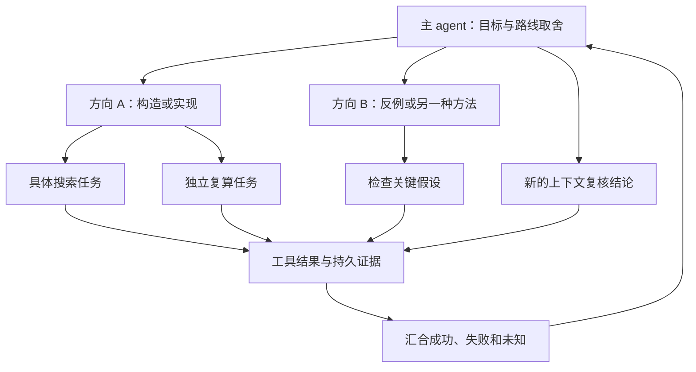

# 两次向下委派的自主研究组织

推荐先用一个主 agent、最多三个方向负责人，以及按需出现的执行子 agent。
“两层”在这里指两次向下委派：root 深度 0 → child 深度 1 → grandchild 深度 2。
如果只需要主 agent 和直接子 agent，将 `max_depth` 设为 1。

同一个 agent 可以不断改进候选程序或构造；研究迭代次数不等于组织层数。
这里实现的是分层委派和调度约束，候选搜索算法仍由 agent、skill 和工具组合决定。
相关开源项目的具体参考点见 [GitHub 调研](autonomous-agent-survey.md)。

## 1. 组织怎样工作



主 agent 负责把目标变成验收条件、分配有差异的路线、停止无效路线、整理最终结果。
子 agent 负责一种方法或一个问题，可继续拆成至多一层具体任务。
孙 agent 做能交付和检查的工作，到深度上限后继续自己推理、迭代与调用工具。
“再开一个 agent”需要一个不同的可交付目标；单纯换个说法重复问题没有必要。

每个逻辑 agent 对应一个持久 `work_id` 和独立的 Infinity 对话。新对话只收到自己
的任务简报、领取信息及公共工具/skill 目录，不复制父 agent 的整段聊天。
它可以通过 `read_work`、`read_effect` 按需读取共享研究结果；这是上下文分离，
不是不同 agent 之间的数据访问隔离。

## 2. 用全局槽位约束实际算力

建议起步配置：

```json
{
  "delegation": {"max_depth": 2, "max_children_per_work": 3},
  "limits": {
    "max_workers": 4,
    "max_parallel_model_calls": 2,
    "max_parallel_tools": 1,
    "max_work_items": 13
  }
}
```

这是配置片段；完整可初始化文件见 [示例](../examples/hierarchical-research/README.md)。

| 参数 | 约束 |
| --- | --- |
| `max_depth` | 从 root 算起的最大委派深度，目前允许 0、1、2 |
| `max_children_per_work` | 每个工作在整个 campaign 中创建的直接孩子总数；不是同时在线孩子数 |
| `max_workers` | 全局同时持有租约的工作数上限 |
| `--workers` | 当前 launcher 的执行槽位上限，不是全树逻辑 agent 总数 |
| `max_parallel_model_calls` | 全局同时在 provider 内运行的模型调用数，可小于执行槽位数 |
| `max_parallel_tools` | 全局同时运行的能力工具调用数 |
| `max_work_items` | 整个 campaign 中已创建的工作总数上限 |

每个节点最多三个孩子、向下两次，整棵树最多 `1 + 3 + 9 = 13` 个逻辑 agent。
它们共用两个推理槽和一个工具槽，不会每个孩子再复制一份并发额度。
孩子完成或失败也不返还创建名额；重试和进程重启不能绕过这个限制。
需要长时间研究时，应该在已有任务内保存结果、迭代方法，确有需求再为新 campaign
提高工作总量。不要用反复创建同义任务代替研究进展。

工作租约和推理槽不同：一个 agent 等待自己的耗时工具时仍持有工作租约；
等待子任务时，`wait_work` 释放工作租约，原生 runner 扣住工具返回并暂停该对话。
父 agent 此时不调用模型，也不占推理、执行或能力工具槽。即使只有一个执行槽，
也能按 root → child → grandchild → child → root 的顺序推进。

## 3. 委派与汇合的实际协议

宿主先将 native owner 绑定到一个 work，再替它领取租约。`bind_worker` 只存在于
宿主 RPC，模型目录不暴露它。一个 owner 不能换绑其它任务，孩子不能领取祖先工作。
分层原生运行时的模型侧 `claim_work` 只能读取宿主已领取的当前租约；没有租约时
返回等待宿主调度。新的领取由 scheduler 完成，避免重试中的 agent 绕过本次
`--workers` 设置，和孩子同时抢占额外执行槽。

模型调用 `delegate_work(work_id, lease_token, goal, brief, skill_names, depends_on)`。
宿主从有效租约推导父节点和深度，在同一 SQLite 事务中检查全局工作数、终身孩子数
和深度；模型不能自行填写 depth，也不能通过旧 `create_work` 接口绕开限制。
`brief` 是至多 32 KiB 的 JSON 对象，只承载任务资料，不产生权限。

一份有用的 brief 应包括目标、范围、实际输入/证据 ID、交付物和验收方法。例如：
“检查已有 n=5 构造的精确可行性，返回检查器 effect ID；不要从可行性推断最优性。”
输入资料不足时明确缺口，不让孩子自己编造数据或来源。

| 等待方式 | 何时恢复 | 适合什么 |
| --- | --- | --- |
| `all_success` | 所有前置工作成功；失败会使依赖工作 blocked | 确实必须全完成的步骤 |
| `all_settled` | 所有前置工作进入 succeeded / failed / blocked / cancelled | 比较研究路线、允许探索失败 |

分层模式每次 `wait_work` 替换当前等待集合；原来的结果仍在账本里。
这样前一轮失败路线不会污染后一轮新的等待条件。恢复时宿主重新领取同一个工作，
在原对话的工具回复中加入 `resume_claim`；agent 必须使用新租约 token。

环检测同时考虑显式依赖和隐式的父节点等待孩子完成关系，拒绝孩子依赖祖先等
会让整条分支永久卡住的组合。父节点完成前检查全部后代，而不只检查直接孩子。
根节点完成、所有工作与工具均结束后，campaign 可以正常结束，即使探索中有失败分支。
`work_graph_completed` 仅表示流程完成，不表示数学目标已经解决。

根任务永久失败或被必需依赖阻塞时，宿主关闭新工作和新工具准入，取消排队任务，
让已经接纳的执行收尾。中间分支失败不会停止其他路线；它尚未结束的后代仍需被
根任务发现和汇合，不能因为直接父节点失败就把活动计算从完成检查中漏掉。

## 4. 放到三个场景里

### 正方形构造或组合优化

主 agent 先固定容器、形状、实例、允许的坐标和评分规则。前两条路线可以分别研究
解析构造与数值搜索，孙任务做具体实例或独立复算。主 agent 在 `all_settled` 后
比较实际证据，最后把剩下的直接孩子名额用于新的上下文复核。

当前内置精确检查器接受 `a+b√2`、最多 64 个正方形。它能检查一份构造的可行性，
面积下界闭合时记录该事实。完整大规模比赛、一般角度、浮点提交格式及更强下界
需要各自的工具；不能由 agent 数量代替这些检查能力。

### Kaggle 预测比赛

方向可以是不同模型家族、特征或损失函数；孙任务执行受控改动与消融。
验证划分、指标与裁判由宿主固定，模型改程序并读取结果。模型调用并发和 GPU 训练
并发分别控制。候选树可以不断增长，不需要增加 agent 的管理层。

现有 schema 1 的 Filament 比赛链仍独立运行。将其训练、评价、导出工具包成 schema 2
能力后才能原样使用本节分层模式；这次没有把两条入口的能力完成迁移。

### 技术研究与专利材料

可以沿用相同的组织和证据系统，改变工作目标与输出：

| 工作 | 具体输出 |
| --- | --- |
| 整理已有技术资料 | 技术特征台账、问题—机制—效果关系、来源与缺口 |
| 检索和比较已有方案 | 实际检索记录、来源版本、相关段落、特征对照 |
| 形成技术交底草稿 | 结构、步骤、实施方式、图示计划及证据引用 |
| 复核权利要求草稿 | 特征 → 说明书段落/实例/附图/原始资料的支持矩阵 |

新增 `patent-research`、`technical-disclosure`、`claim-support-review` 三个 skill。
它们支持组织和复核资料，不自带网络检索或专利数据库工具。没有工具或资料时，
输出实际缺口和待执行计划；不能把未执行检索写成“已查无相同方案”。

这些结构参考 [CNIPA 专利法第二十六条](https://www.cnipa.gov.cn/art/2020/11/23/art_97_155167.html)
和 [实施细则第二十条](https://www.cnipa.gov.cn/art/2023/12/21/art_98_189197.html) 的说明书、
权利要求及技术描述要求。完整性检查不能替代新颖性、创造性或授权判断。
示例只使用明确标注为虚构的技术资料，不执行对外提交。

## 5. 长时间运行需要哪些恢复信息

保存的是目标、版本、简报、依赖、租约、完成结果和工具回执。每次失败与重试都留痕；
已完成工具的原始结果可以被替代 worker 重新发现。中断且结果未知的工具不自动重放。
父子任务等待不能靠一直向模型问“孩子做完了吗”实现，应由账本状态驱动恢复。

同一进程内，父 agent 等待后回到原 native 对话。跨进程重启会建立新对话并读取
持久结果，不保证还原未记录的推理文本。当前也没有训练 checkpoint 精确续跑、
多机器资源调度、自动 skill 晋级或每角色独立模型路由。

这种分工与 [Anthropic 的多 agent 研究系统说明](https://www.anthropic.com/research/multi-agent-research-system)
中的独立上下文、明确委派和结果汇合相契合。DeepSeek 的 Ticket / Assignment 分离
为持久目标提供参考，但“等待孩子释放父槽位”是这里的设计选择；不能误写成其原型
已经提供的同一语义。参见固定版本的
[execution 文档](https://github.com/deepseek-ai/dsh-superagent-prototype/blob/8c32a9dc5d72c033816c6a8110b37f40cf94fba4/docs/003-execution.md)。

## 6. 兼容性与验证边界

没有 `delegation` 字段的 schema 2 campaign 保持原来的平面 worker 池和任意工作领取；
`parent_id` 在该模式仍只表示来源。旧配置不会被补写新的委派字段，已有任务哈希不变。
辅助表以事务方式添加，旧依赖默认 `all_success`；不能通过修改 JSON 把已运行的平面
campaign 变成层级 campaign。

测试使用真实 Python RPC、SQLite 和原生 Infinity，模型回复来自可控 fixture。
验证的是限制、等待、恢复、上下文分离和证据流；本次没有真实付费模型长跑或自动
数学发现结果。具体执行结果随 [验证记录](../VALIDATION.md) 更新。
