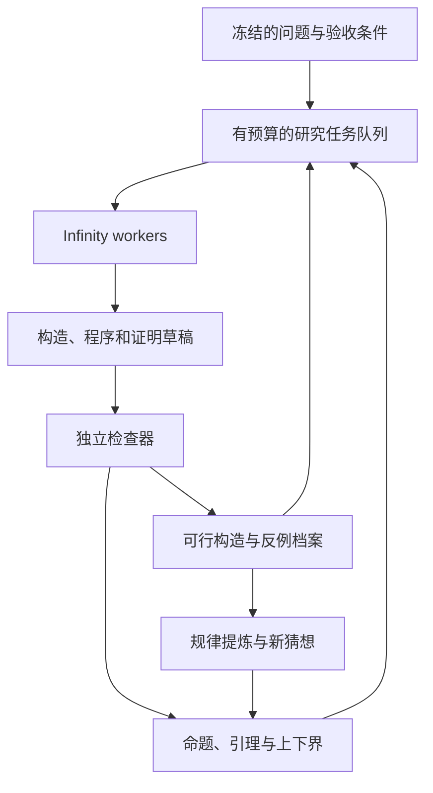

# 数学研究架构：构造档案、命题图和独立验证

设计日期：2026-11-05。

**状态：这是现有自主研究运行器的下一版设计。** 当前运行器仍只注册了
`filament` 和 `smoke`，还没有接入 Squares in Squares 或 Lean。本次新增的
[精确构造示例](../examples/squares-in-squares/README.md)可以单独执行，
用于检查数学证据的表示；它不是已经上线的数学 agent 系统。

## 1. 统一执行机制，分别定义研究成果

现有 Infinity worker、异步工具结果、隔离执行、预算预留、租约和恢复机制可以保留。
需要改的是“什么算进展”和“什么算完成”。

| 任务 | 可以接受的成果 | 完成条件 |
| --- | --- | --- |
| 经验型预测任务 | 固定验证集上的模型表现 | 选优后执行预留的最终评测 |
| 数学构造优化 | 满足约束的有限对象及其目标值 | 达到目标，或预算结束时交付最好构造与未闭合的界 |
| 命题证明 | 固定命题和假设下的证明或严格反例 | 检查器接受目标证明，或接受对该目标的反例 |

一个数学任务可以同时包含后两种目标。例如先寻找更紧的方块布局，再尝试证明其最优性。
没有连续得分的证明任务不应伪造一个“正确率”来兼容机器学习接口。

## 2. 两套研究状态，共享一个任务队列



验证器是宿主程序。LLM 可以选择下一项工作、提出猜想、改程序、解释失败；
不能通过文字声明把某条记录变成 `proved`。

### 持久对象

| 对象 | 关键字段和含义 |
| --- | --- |
| `ProblemContract` | 原始题目、形式目标、量词、假设、允许公理、定义版本、指标、资源与停止规则 |
| `Claim` | 命题内容、局部假设、精确目标指纹、依赖、证明状态 |
| `Strategy` | 搜索/构造/证明程序、研究方向、适用实例范围、版本与来源 |
| `Run` | 策略、目标实例、输入产物、seed、工具链、实际资源消耗和终止原因 |
| `Artifact` | 布局、反例、证书、Lean 源码、solver checkpoint 等不可变文件及哈希 |
| `Verification` | 被检查对象、检查器版本、输入/证书哈希、结论与诊断 |
| `InstanceArchive` | 每个实例的最好可行对象，以及不同结构/方法的备选对象 |
| `Bound` | 上界或下界、作用范围、证明或构造证书、依赖命题 |
| `WorkItem` | 具体待办、资源租约、预期产物、预算、重试与停滞状态 |

`Strategy`、`Run` 和 `Artifact` 分开存：一种算法可能改善多个 n；
一个布局也可能经过多种算法继续改进。单一 `parent_id` 无法表达这种关系。

大量坐标通过只读产物引用传给执行器，LLM 只读取摘要、选定局部、接触图或诊断。
不能把整份提交 CSV 塞进提示词，也不能让模型通过任意宿主路径读取文件。

## 3. 验证结论必须带上对象和范围

建议使用以下结构，而不是只有 `score: float`：

```json
{
  "claim_kind": "feasibility",
  "subject_hash": "sha256:...",
  "judgement": "verified",
  "method": "exact_arithmetic",
  "scope": {"problem": "unit_squares", "n": 5},
  "objective": {"upper_bound": "2 + sqrt(2)/2"},
  "certificate_ref": "sha256:...",
  "verifier_id": "registered-host-checker@version",
  "assumptions": [],
  "diagnostics": {}
}
```

这是拟议格式，不是当前 RPC 已接受的接口。

`judgement` 至少区分 `verified`、`refuted`、`unknown`、`checker_error`。
超时、精度不足、编译错误分别记录；它们不会证明命题为假。
一次数值搜索没找到反例，也不会证明全称命题为真。

另外分别保存 `competition_valid` 与 `mathematically_certified`。
通过比赛的数值检查、通过精确几何检查、通过形式证明内核，是不同验收结果，
不构成一个可以任意向上升级的“置信度”分数。

来源、许可证和允许使用的范围也属于产物元数据。公开可下载不自动等于比赛允许复用；
本设计尚未确认 Squares in Squares 的具体外部资源/共享条款。

## 4. 一般证明任务：分解、反驳、复用

一个目标可以有多条候选证明路线，各路线内部又需要若干引理。
路线之间是 OR，一条路线所需的引理之间是 AND。

例如：路线 A 需要 L1、L2，路线 B 需要 M1、M2。若 L2 超时，保留已证明的 L1，
继续分解 L2 或分配任务给路线 B；若 L2 得到严格反例，撤销依赖它的路线。
证明图中的条件性结论必须保留假设，不能偷偷作为无条件定理被别处引用。

图节点成功还不够：最终必须检查“这些引理确实推出冻结目标”的完整证明项。
循环依赖本身不能形成证明；归纳等循环论证必须由相应的合法证明规则支撑。
相似文本可以帮助检索，但只有已核查的等价关系才能合并两个不同目标。

### Lean 适配计划

宿主固定 `Challenge.lean`、其定义与依赖、目标 theorem 名称、工具链、Mathlib 版本
和允许公理。worker 生成解答文件与辅助引理，在隔离环境中构建。
验收时重新检查导出的证明，并比较它是否对应原目标及允许的假设。

[Lean 官方验证说明](https://lean-lang.org/doc/reference/latest/ValidatingProofs/)
区分构建成功、公理依赖检查、证明重检和可信 challenge 比较。
[Lean 4.35.0](https://lean-lang.org/doc/reference/latest/releases/v4.35.0/)
提供 `lake check` 与 `lake comparator` 入口。本设计选用这类验证路径；
本仓库尚未安装、调用或验证这些工具。

自然语言到形式化命题的翻译本身也可能有误。保留原文、形式目标和对应关系，
让验收明确指出已经证明的是哪一个形式命题。自动翻译不能让这个问题消失。

## 5. Squares in Squares 的任务模型

官方入口：

- [比赛](https://www.kaggle.com/competitions/squares-in-squares)
- [提交数据说明](https://www.kaggle.com/competitions/squares-in-squares/data)
- [官方 metric](https://www.kaggle.com/code/metric/squares-in-squares/output)

每个实例 n 的候选是 n 个单位正方形的中心和旋转。正式提交字段为
`id,n,square_id,x,y,angle`，angle 使用弧度，实例范围是 1 到 1000。
全部提交的行数是 1000×1001/2 = 500500，所以日常实验应允许只处理少量实例。

本次实际读取的官方 notebook 为 version 20，合并 code cells 的 SHA-256 为：

```text
d269f24b02d5f33fbd2149f76b83414b3b446be4d02776560e04631af3365ccf
```

正式接入时应保存原始来源、版本及许可证，并固定评测环境；本次没有将官方代码
复制成运行器中的已注册适配器，也没有执行正式 CSV 评分。

### 逐实例档案

保存每个 n 的可行布局与边长，再合并完整提交。官方总目标为各实例
`L_n / sqrt(n) - 1` 之和；非法或缺失实例使用网格基线罚分。
因此尤其不能把完全平方数的零罚分误认成找到了合法最优布局。
只有通过可行性检查的产物才能更新 `instance_best[n]`；没有改进的实例填入真实网格布局。

最后按精确的输出字符串重新验证整个 CSV，再生成提交包。
一份旧的精确构型证书不能替代对四舍五入后文件的检查。

### 上下界分开研究

定义 L*_n 为原问题最优边长。经证明的下界 B_n 与可行构型给出的上界 U_n 满足：

```text
B_n <= L*_n <= U_n
```

面积给出初始下界 sqrt(n)；网格给出上界 ceil(sqrt(n))。
当 n=k²，两者等于 k，可以关闭这个实例的最优性任务。
其他实例的研究可以同时降低 U_n、提高 B_n。仅仅长时间没找到更小布局不能提高 B_n。

在每题目标的线性部分，同一边长改善 deltaL 对总分的贡献是 deltaL/sqrt(n)。
这个权重可以用于资源调度，但不能代替实际改善概率、运行代价和不同方法的迁移价值。

### 需要纠正的数学推断

- 把角度限制为几个值后求得最优，只证明受限问题的最优性。它不能直接给原题下界。
- 接触图或某种排列结构可以帮助搜索；除非证明覆盖所有情况，否则不能拿其失败证明全局不可行。
- 平移、单块旋转 90 度、排列编号和外框的正方形对称可以用于去重；任意旋转全部布局可能改变轴对齐外框边长，不能直接当作目标不变的归一化。
- 用不同数值方法得到相同结果可以增强工程信心，但不是全局最优性证明。

## 6. 让 agent 探索数学表示

为每种表示保留独立的候选档案，避免所有 worker 只修改一个领先程序：

| 研究方向 | 实际动作 |
| --- | --- |
| 网格与边界缺陷 | 从合法网格出发，重排边界空隙和少量旋转块 |
| 连续坐标搜索 | 写局部优化、退火、大邻域删除重插等程序 |
| 接触图搜索 | 先改接触关系，再求解坐标，并核查额外碰撞 |
| 相邻规模迁移 | 从较大实例删除方块，或在较小实例插入与重新压缩 |
| 精确表示 | 尝试有理中心、代数数、可检查的旋转参数 |
| 构造族 | 从多个 n 的规律提出递推或参数公式，再创建待证明命题 |

一个可探索的旋转表示为：

```text
cos(theta) = (1 - t²)/(1 + t²)
sin(theta) = 2t/(1 + t²)
```

若 t 与中心坐标为有理数，顶点和分离不等式可用有理算术检查。
该表示是否有利要通过实验判断。转换为比赛要求的十进制角度后，对象已经改变，
必须重新验收。精确相切也可能使普通区间检查无法定案，需要精确处理或留出可验证余量。

随附的 n=5 示例使用 Q(sqrt(2)) 精确数，给出边长 `2 + sqrt(2)/2` 的可行布局，
演示“有限构造证书”；n=4 示例展示面积下界与构造上界闭合。
示例不声称发现新纪录，也不声称证明 n=5 的最优性。

## 7. Worker 组织与长时间调度

任务队列提供 `explore_representation`、`improve_solver`、`construct`、
`search_counterexample`、`propose_lemma`、`prove_goal`、`generalize` 等工作单。
角色随工作单变化；验证是宿主服务，不需要额外雇一个 LLM 判断数学真伪。

100 是逻辑研究 worker 的容量，不是要求 100 个模型一直输出。
另设模型请求并发、CPU/GPU 实验并发、证明检查并发与全局 token/费用预算。
比如先以 8–16 个活跃研究 worker 校准方法价值，再决定是否扩到 100。
这是一项部署建议，没有宣称更多 worker 必然更有效。

调度依据分为：

1. 构造任务：已验证的目标改善、单位计算代价、实例覆盖与结构多样性。
2. 证明任务：关键子目标被关闭、共享引理被证明、错误路线被严格反驳。
3. 探索任务：保留独立额度，不因暂时没有分数改善就永久淘汰新表示。

不要奖励草稿长度、无关引理数量或 agent 投票。模型的“有希望”评价只能调整尝试顺序。
验证器 backlog 增长时优先消化候选；持续无进展时降低分支额度、替换表示或换路线。

每个工作单有 lease、deadline 和资源预留。检查器崩溃记为基础设施错误；
数学上的 undecided 记为 unknown。恢复只接手未完成工作，不重复扣预算或凭空重置计算。
checkpoint 只有在策略明确支持、输入和工具链匹配时才能恢复，否则保留已完成产物并开始新 run。

## 8. 对现有代码的修改清单

| 当前代码 | 下一版需要做的改变 |
| --- | --- |
| `spec.py` 强制私有 validation/holdout 标签 | 按 `task.kind` 验证输入；构造任务允许无标签实例集 |
| `store.py` 只有全局 `best_id` | 增加按实例与结构分组的档案、命题图、验证记录及上下界 |
| `propose` 指纹以源码、seed、timeout 为主 | 纳入目标实例、输入产物、策略参数、工具链和评测版本 |
| `core._evidence` / `finish` 强制标量 score | 接受有类型的检查结论；可行性与性能独立处理 |
| 候选之间只能读取源码和摘要 | 增加受控的只读 artifact 引用和明确的 warm-start 输入 |
| `finalize` 固定重跑一个候选的 holdout | 按任务使用 `holdout_once`、`certify_and_bundle` 或 `prove_target` |
| 源码仅允许 py/json/txt/md | 通过受控工具链注册 Lean/C++ 等，不向模型开放任意宿主命令 |
| 单一 provider/model 与 worker 数绑定并发 | 新增独立模型并发与可选路由，保留每次调用的持久预算 |

原来的 schema v1 campaign 保持原语义。新机制使用 schema v2；不在运行中替换旧账本的指标、
真假状态或 final 规则。`predict-test` 仍服务原有预测任务，不拿它假扮数学任务最终验收。

数学长推理还需要 provider 正确保留其要求的 reasoning/tool-turn 状态。
当前 DeepSeek 通用 Chat Completions 路径使用 `--disable-thinking` 规避兼容问题；
这不等于已经实现了适合长证明的 thinking 模式。新路由/适配器应先通过真实协议回合测试。

### 实施顺序与验收

第一步：实现构造任务模式、逐 n 档案、官方 metric 固定、网格基线和 CSV 合并。
验证缺失题不会冒充最优、局部改善不会丢掉其他题的成果、实例/初始构型变化不会错误命中去重。

第二步：加入 solver 输入产物、不同方法档案与受控迁移，进行短预算搜索。
验证收益来自合法布局，并把 wall time、CPU/GPU 时间、LLM token 和验证时间分别记录。

第三步：接入严格构型证书、上下界注册、命题依赖图和 Lean 验收。
加入目标被改写、依赖含未完成证明、循环引理、unknown 被误作 false 等针对性检查。

第四步：才扩大到长时多 worker 研究，比较少量 worker 与 100-worker 配置在相同总预算下的结果。
Kaggle 构型提交无需隐藏标签；衡量搜索策略的泛化能力时可以另设留出的实例/seed，
这是一项算法实验，不能与比赛正式评价规则混为一谈。

## 9. 费用设计

把调用数、token、CPU/GPU 时间和检查器时间分开计费与预留：

```text
总费用 = 模型输入/输出费用 + 数值计算费用 + 验证费用 + 搜索/抓取等服务费用
```

按 2026-11-05 查询的 [DeepSeek 官方定价](https://api-docs.deepseek.com/quick_start/pricing/)，
采用峰时、未缓存的每百万 token 价格作保守示例：Flash 输入 $0.30 / 输出 $1.20；
Pro 输入 $1.32 / 输出 $3.96。以下只是算术预算，不代表完成某道题的预计费用。

| 调用计划 | 每次输入/输出 token | 全 Flash | 90% Flash + 10% Pro |
| --- | --- | --- | --- |
| 200 次 | 8000 / 2000 | $0.96 | $1.23 |
| 2000 次 | 8000 / 2000 | $9.60 | $12.34 |
| 6000 次 | 20000 / 4000 | $64.80 | $83.66 |

假定两类模型的平均长度相同，不计缓存折扣；实际长推理、重试、上下文增长和工具调用都会改变费用。
上述金额不包含 CPU/GPU、检查器、搜索/抓取、电费或云机器。混合路由也是下一版设计，
当前 launcher 每场 campaign 选择一个模型。

预算器应按输入长度估算和最大输出预留费用，得到真实 usage 后结算；
usage 缺失时保留预留，不能记成免费。价格与币种也要固定成 campaign 快照。
若 provider 不提供可靠 tokenizer/上界，这种费用限制仍有估算误差；硬上限还需 provider 侧消费限额配合。

## 10. 参考机制

以下是组织方法的来源，不表示本仓库复现了这些系统的模型或成绩：

- [FunSearch](https://pmc.ncbi.nlm.nih.gov/articles/PMC10794145/)：多个独立程序种群，保留不同解法。
- [AlphaEvolve](https://arxiv.org/html/2506.13131v1)：演化搜索算法，分阶段评估，归档多个有用程序。
- [Mathematical exploration and discovery at scale](https://arxiv.org/html/2511.02864v1)：把有限构造、一般公式和证明作为不同阶段。
- [Aristotle](https://arxiv.org/html/2510.01346v1)：非形式化思路与引理分解配合可验证证明搜索。
- Lean 官方验证说明：冻结目标、检查假设并独立重检证明。

自然语言评议可以帮助选择路线；数学结论的状态最终由对应的检查器及其明确的信任前提决定。
